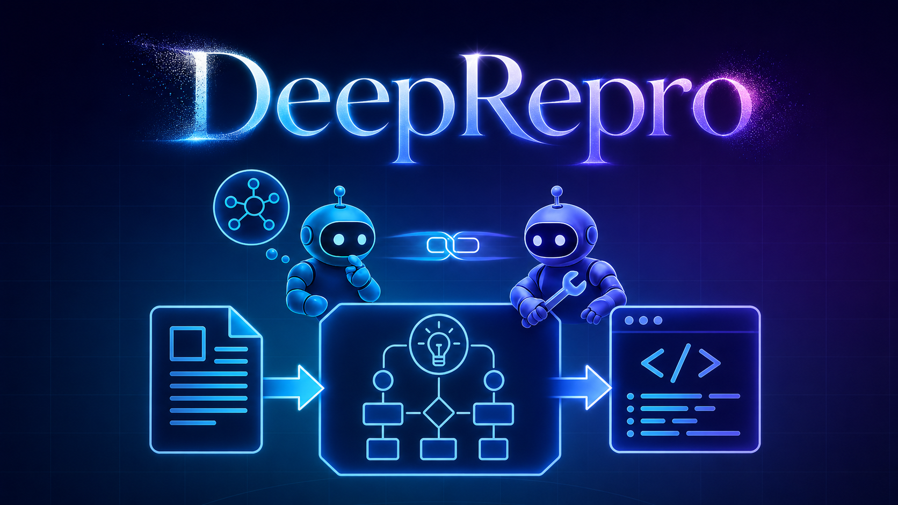

<div align="center">



# DeepRepro

### State-Aware Subplanning for Paper Reproduction in Evolving Repositories

<p>
  <a href="#quick-start">Quick Start</a> ·
  <a href="#workflow-modes">Workflow Modes</a> ·
  <a href="#configuration">Configuration</a> ·
  <a href="#acknowledgements">Acknowledgements</a>
</p>

</div>

---

## Overview

DeepRepro turns a scientific paper into a runnable code repository through a structured multi-agent workflow.  
It combines paper understanding, repository-level blueprint planning, round-level subplanning, tool-mediated implementation, asynchronous memory management, and automatic repair.

## Highlights

- 🧠 **Multi-agent collaboration** — dedicated agents handle analysis, planning, execution, memory, and repair.
- 🧭 **Deep subplanning** — each round can produce a structured subplan with explicit file-level guidance.
- 🛠️ **Automatic issue repair** — diagnostics feed back into later rounds to correct interface or implementation gaps.
- 💾 **Efficient memory management** — implementation summaries are compressed asynchronously to avoid blocking execution.
- 👀 **Process visibility** — the UI surfaces progress, generated files, diagnostics, and run-time state.

## Workflow Modes

DeepRepro provides four paper-to-code modes:

| Mode | Subplanning | Reference indexing | Description |
| --- | --- | --- | --- |
| `raw_fast` | Lightweight | No | Fast generation without reference-code indexing. |
| `infer_fast` | Lightweight | Yes | Fast generation with reference-code indexing. |
| `raw_deepplan` | Deep | No | Deep-planning generation without reference-code indexing. |
| `infer_deepplan` | Deep | Yes | Deep-planning generation with reference-code indexing. |

Fast modes keep the loop lightweight. DeepPlan modes add a subplan agent that writes round-level instructions for the execute agent and coordinates diagnostics and repairs.

## Quick Start

### 1. Prepare the environment

DeepRepro requires:

- Python 3.12 (validated demo environment)
- Node.js and npm
- A local model/API configuration in `mcp_agent.config.yaml` and `mcp_agent.secrets.yaml`

Install the Python dependencies first:

```bash
python3.12 -m venv .venv
source .venv/bin/activate
python -m pip install -r requirements.txt
```

For the exact validated demo environment, install `requirements-demo.lock.txt` instead.

Install the frontend dependencies:

```bash
cd ui/frontend
npm install
cd ../..
```

### 2. Configure model access

Copy `mcp_agent.secrets.example.yaml` to the ignored local file `mcp_agent.secrets.yaml`, then fill in the provider API key(s). Never commit the secrets file.
Then adjust `mcp_agent.config.yaml` if you want to change providers, model names, proxy settings, or MCP server settings.

### 3. Start DeepRepro

```bash
python ./deeprepro.py --local
```

### CIKM meeting demo (本地验收)

在本机双击 `start_demo.command`，或在仓库目录运行 `./start_demo.command`，然后打开 <http://127.0.0.1:5173/>。双击 `stop_demo.command` 或在启动终端按 Ctrl+C 停止服务；再次启动后打开原任务链接，点击 **Resume run** 继续。不要删除 `logs/runs/`、上传的输入文件或 `deeprepro_code/`，它们保存任务及恢复进度。

- 页面 **Pause** 保存进度并取消正在进行的模型请求；**Resume run** 复用已完成的阶段和文件。出错任务提供 **Retry from checkpoint**。服务意外退出后，未完成任务恢复为 paused，等待手动继续。
- 保存粒度是阶段和成功写入的文件。未完成的阶段/模型请求会重试；尚未落盘的响应无法续接。恢复前用 SHA-256 校验已完成文件；被改动或丢失的文件会重新生成。恢复仍会执行最终质量检查。
- **Active time** 是各次运行的累计执行时间，排除暂停等待；token 是 API 返回的累计用量。取消或掉线请求可能已计费但没有返回 usage，因此统计不是账单；强杀时以最近一次落盘统计为准。并行请求的时长之和可能超过执行时间。
- 当前配置使用 DeepSeek `deepseek-flash`，关闭 thinking，支持现有工具调用历史。无需 Brave key 的直接模式已验证；参考仓库检索/indexing、批量队列及完整论文指标复现不属于本次验收。
- 运行记录、事件和 usage 位于 `logs/runs/<task-id>.json`。页面支持结果预览、代码 ZIP 和 metrics JSON 下载，刷新页面或重启后仍可查看。

会议案例来自 [OpenAI PaperBench BaM](https://github.com/openai/frontier-evals/tree/main/project/paperbench/data/papers/bam)，只用摘要及方法节选做二维高斯的 NumPy smoke test，不代表完整论文复现或 PaperBench 得分。重复执行：

```bash
.venv/bin/python demo/run_smoke.py
```

已完成的 DeepPlan 展示任务：`f3bb6ac2-1bf2-4514-8ee4-410a667260a7`，143.7 秒、16 次模型请求、118,020 tokens，生成 3 个文件；未经人工修改的 `demo.py` 运行和断言通过。访问 `http://127.0.0.1:5173/?task=<task-id>` 可恢复展示。更早的试跑曾出现生成测试调用参数不匹配，已手动修正；不把它算作未经修改即通过的结果。

恢复验收任务：`7d3fdcd7-892d-49a3-8ce6-ebd94971521f`。真实执行“写完 bam.py → Pause → 重启服务 → Resume → 运行中强制终止后端 → 重启 → Resume”，最终完成 4 个文件（含 requirements.txt）。计划内容和首次生成的 bam.py 哈希保持不变；未经修改的 demo.py 输出 ALL CHECKS PASSED（约 0.019 秒）。记录执行时间 198.5 秒、142,985 tokens、21 次请求（20 次返回 usage、1 次主动取消、0 次报告失败），不含暂停等待，也不代表完整论文精度。

上述任务记录仅保存在验收机器上，不随仓库分发；新环境运行 `demo/run_smoke.py` 会生成自己的任务 ID 和展示链接。

本次修复包括 MCP 依赖版本冲突、文本误当 PDF、空密钥覆盖已有配置、失败/取消仍显示成功、后台 summary 未随任务取消、结果恢复与文件重复计数，以及启动脚本误杀占用端口的其他进程。环境快照在 `requirements-demo.lock.txt`；可用 `.venv/bin/python -m pytest -q` 和前端 `npm run build` 做回归验证。

This starts the local backend and frontend.

- Frontend: `http://localhost:5173`
- Backend: `http://localhost:8000`

## Requirements

- Python 3.12 (validated demo environment)
- Node.js and npm
- Python packages from `requirements.txt`
- Frontend packages from `ui/frontend/package.json`
- Local model configuration in `mcp_agent.config.yaml` and `mcp_agent.secrets.yaml`

## Configuration

1. Edit `mcp_agent.secrets.yaml` and fill in the provider API key(s) you want to use locally.
2. Adjust `mcp_agent.config.yaml` if you want to change providers, model names, or MCP server settings.
3. Do not commit real private API keys to a public fork.

`mcp_agent.config.yaml` controls the provider, model defaults, document segmentation, and MCP servers.

## Repository Layout

- `deeprepro.py`: local launcher.
- `ui/`: frontend and backend services.
- `workflows/`: orchestration logic.
- `tools/`: PDF processing, indexing, and utility helpers.
- `prompts/`: agent prompt templates.
- `assets/`: public logos and illustration assets.
- `docs/`: evaluation notes and benchmark guidance.
- `uploads/`: local task uploads and intermediate files.

## Acknowledgements

DeepRepro is built on top of [HKUDS/DeepCode](https://github.com/HKUDS/DeepCode) and also takes inspiration from [going-doer/Paper2Code](https://github.com/going-doer/Paper2Code). We thank these projects for their valuable contributions to open scientific code generation and paper-to-code reproduction.

## License

See `LICENSE` for details.

